```console
$ whoami --verbose

  name ................................. Mag
  role ................................. developer · PC technician
  builds ............................... desktop apps in Rust, websites, automation
  fixes ................................ PCs, hardware, Windows
  cares about .......................... clean design and honest software
  status ............................... v2.0, freshly installed
```

<br>


<br><br>

<table>
<tr>
<td width="50%" valign="top">

**👋&nbsp; About**

I build practical software for real problems: tools that diagnose,
repair and explain, with interfaces that feel normal and just work.
Fast, safe and no nonsense.

</td>
<td width="50%" valign="top">

**🧰&nbsp; Stack**

`Rust` `egui` `SQLite` `PowerShell` `Python`<br>
`HTML` `CSS` `JavaScript` `Git` `GitHub Actions`

</td>
</tr>
</table>
